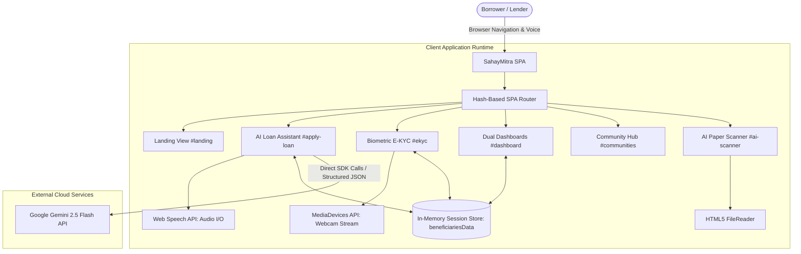

<div align="center">
  

  # SahayMitra

  **Credit for All, by All: An AI-Powered Fair and Transparent Microcredit Platform**

  [](#prototype-disclaimer)
  [](LICENSE)
  [](https://www.typescriptlang.org/)
  [](https://react.dev/)
  [](https://vitejs.dev/)
  [](https://aistudio.google.com/)

  [View in Google AI Studio](https://ai.studio/apps/drive/1AdO-sLIvWjCMntTF0anJ94EdhLOBIknG) • [Report Bug](.github/ISSUE_TEMPLATE/bug_report.md) • [Request Feature](.github/ISSUE_TEMPLATE/feature_request.md)
</div>

---

## Table of Contents
- [About the Project](#about-the-project)
  - [Problem Statement](#problem-statement)
  - [Our Solution](#our-solution)
  - [Key Features](#key-features)
  - [Prototype Disclaimer](#prototype-disclaimer)
- [Demo](#demo)
- [Tech Stack](#tech-stack)
- [System Architecture](#system-architecture)
- [Project Structure](#project-structure)
- [Getting Started](#getting-started)
  - [Prerequisites](#prerequisites)
  - [Installation](#installation)
  - [Environment Variables](#environment-variables)
  - [Running Locally](#running-locally)
- [Usage & Demo Accounts](#usage--demo-accounts)
- [API Reference](#api-reference)
- [Testing](#testing)
- [Roadmap & Future Scope](#roadmap--future-scope)
- [Contributing](#contributing)
- [License](#license)
- [Team](#team)
- [Acknowledgements](#acknowledgements)

---

## About the Project

### Problem Statement
<!-- TODO: Add SIH Problem Statement Details -->
- **Hackathon**: Smart India Hackathon (SIH) 2025
- **Problem Statement ID**: `<!-- TODO: PS ID (e.g., SIH1234) -->`
- **Problem Statement Title**: `<!-- TODO: PS Title -->`
- **Theme**: `<!-- TODO: Theme (e.g., Smart Automation / FinTech / Social Inclusion) -->`
- **Organization / Ministry**: `<!-- TODO: Ministry or Organization (e.g., NBCFDC / Ministry of Social Justice & Empowerment) -->`

Millions of informal workers, micro-entrepreneurs, and rural artisans in India struggle to access affordable formal credit due to a lack of conventional collateral, credit history (CIBIL score), or a structured digital financial footprint. As a result, they remain vulnerable to predatory local moneylenders.

### Our Solution
**SahayMitra** is a prototype AI-assisted micro-lending and credit assessment platform. It bridges the financial inclusion gap by:
- Offering an intuitive, **voice-enabled conversational assistant** that gathers loan requirements in natural language.
- Utilizing **alternative data signals and Explainable AI (XAI)** with SHAP feature breakdowns so applicants and lenders clearly understand why an evaluation was made.
- Introducing a dynamic **"Living Loan" management** system where borrowers earn social impact reward tokens for on-time repayments and community participation.
- Equipping field credit officers with an **AI Record Scanner** to digitize non-digital handwritten ledgers.

### Key Features (Implemented in Code)
- :speech_balloon: **Conversational Loan Origination**: Multi-turn dialog guided by Google Gemini (`gemini-2.5-flash`) with structured schema extraction for loan amount, applicant name, and purpose.
- :microphone: **Bilingual Voice Interface**: Speech-to-text input via the browser Web Speech API (`en-IN`) and automated text-to-speech voice guidance.
- :camera: **Biometric E-KYC Simulation**: Interactive 4-step onboarding flow (Aadhaar &rarr; OTP &rarr; live webcam facial verification &rarr; approval).
- :bar_chart: **Explainable AI (XAI) Scoring**: Transparent credit scores based on a 600 base score combined with positive/negative SHAP feature contributions (e.g., utility bill stability, community trust).
- :busts_in_silhouette: **Dual-Persona Dashboards**:
  - **Borrower View**: Visual application progress tracker, "Living Loan" draw-down & repayment simulator, statement ledger, and Social Impact Reward token redemption.
  - **Lender View**: Portfolio analytics (Total Beneficiaries, Total Utilized Capital, Average Credit Score), risk band breakdown chart, and loan application review/approval actions.
- :handshake: **Community Lending Hub**: Regional cooperative lending circles (e.g., *Jaipur Artisans Collective*, *Green Valley Farmers*) with trust scores and group membership.
- :page_facing_up: **AI Record Scanner (Preview)**: Upload and preview physical ledger images with simulated CSV digitization for non-digital credit records.

### Prototype Disclaimer
> [!WARNING]
> **Hackathon Prototype Notice**: SahayMitra is an early-stage proof of concept developed for Smart India Hackathon 2025. It uses sample and simulated datasets stored in volatile browser memory. It is **not** a production banking application, does not process actual currency or live Aadhaar data, and has not undergone formal security audits.

---

## Demo

| Conversational Loan Assistant | Dual-Perspective Dashboard |
| :---: | :---: |
| <!-- TODO: Add Chatbot Screenshot / GIF --> `` | <!-- TODO: Add Dashboard Screenshot / GIF --> `` |

| Biometric E-KYC Flow | Community Lending Hub |
| :---: | :---: |
| <!-- TODO: Add E-KYC Screenshot --> `` | <!-- TODO: Add Community Screenshot --> `` |

* **Interactive Preview**: [Google AI Studio Web Application](https://ai.studio/apps/drive/1AdO-sLIvWjCMntTF0anJ94EdhLOBIknG)
* **Demo Video**: <!-- TODO: Add link to YouTube / Google Drive demonstration video --> `[Watch Demo Video](https://youtube.com/...)`

---

## Tech Stack

| Layer | Technology | Purpose in Project |
| :--- | :--- | :--- |
| **Frontend Framework** | [React 19](https://react.dev/) (`^19.2.0`) | Client-side reactive UI rendering |
| **Language** | [TypeScript](https://www.typescriptlang.org/) (`~5.8.2`) | Type safety and component interfaces |
| **Build Tool & Server** | [Vite 6](https://vitejs.dev/) (`^6.2.0`) | Fast HMR dev server and client bundling |
| **Styling & Icons** | [TailwindCSS](https://tailwindcss.com/) & [Font Awesome 6](https://fontawesome.com/) | Responsive UI utility classes and icon set |
| **AI / LLM Engine** | [Google GenAI SDK](https://www.npmjs.com/package/@google/genai) (`^1.22.0`) | Connects to `gemini-2.5-flash` for conversational loan origination |
| **Voice Processing** | Web Speech API | Browser-native `SpeechRecognition` (STT) and `SpeechSynthesis` (TTS) |
| **Biometric Capture** | MediaDevices API | Browser webcam video stream access for E-KYC face scan |
| **Typography** | Google Fonts (`Poppins`, `Inter`) | Accessible, clean typography |

---

## System Architecture



For detailed component interaction diagrams and architecture decisions, see [docs/ARCHITECTURE.md](docs/ARCHITECTURE.md).

---

## Project Structure

```
SahayMitra/
├── .env.example                     # Sample environment variable template
├── .env.local                       # Local environment file (contains active GEMINI_API_KEY)
├── .gitignore                       # Git ignore rules for node_modules and env files
├── .github/                         # GitHub issue and PR templates
│   ├── ISSUE_TEMPLATE/
│   │   ├── bug_report.md            # Bug reporting template
│   │   └── feature_request.md       # Feature request template
│   └── PULL_REQUEST_TEMPLATE.md     # Code contribution checklist
├── CHANGELOG.md                     # Semantic versioning release log
├── CODE_OF_CONDUCT.md               # Contributor Covenant v2.1 code of conduct
├── CONTRIBUTING.md                  # Contribution and branch naming guidelines
├── LICENSE                          # MIT License
├── README.md                        # Primary project documentation (this file)
├── App.tsx                          # [Placeholder] Reserved for future root React component
├── index.html                       # Application shell, Tailwind setup, fonts, and DOM layout
├── index.tsx                        # Main application logic: routing, AI chat, E-KYC, dashboards
├── metadata.json                    # AI Studio and frame permissions config (camera access)
├── package.json                     # Project dependencies and npm scripts
├── tsconfig.json                    # TypeScript compiler configuration
├── types.ts                         # [Placeholder] Reserved for shared TypeScript interfaces
├── vite.config.ts                   # Vite configuration (port 3000, env definition, path aliases)
├── components/                      # Modular UI component stubs (reserved for React refactor)
│   ├── Phase1_Onboarding.tsx        # [Placeholder] Onboarding phase component
│   ├── Phase2_DataIngestion.tsx     # [Placeholder] Data ingestion component
│   ├── Phase3_AICore.tsx            # [Placeholder] AI credit scoring component
│   ├── Phase4_Disbursement.tsx      # [Placeholder] Disbursement & repayment component
│   ├── Phase5_LoanMonitoring.tsx    # [Placeholder] Loan monitoring component
│   └── common/                      # [Placeholder] Reusable UI atoms (Button, Card, Stepper, etc.)
├── docs/                            # Supplementary technical documentation
│   ├── API.md                       # API schemas and Gemini integration reference
│   ├── ARCHITECTURE.md              # In-depth system diagrams and architectural choices
│   ├── PROJECT_STRUCTURE.md         # Annotated repository structure and module guide
│   └── SETUP.md                     # Detailed local setup and troubleshooting manual
└── services/                        # Service layer stubs
    └── geminiService.ts             # [Placeholder] Reserved for decoupled Gemini API calls
```

For complete file descriptions, see [docs/PROJECT_STRUCTURE.md](docs/PROJECT_STRUCTURE.md).

---

## Getting Started

### Prerequisites
- **Node.js**: `v18.0.0` or higher (tested with `v20.x` / `v22.x`)
- **npm**: `v9.0.0` or higher
- **Google Gemini API Key**: Required for the loan assistant chatbot ([Get an API Key](https://aistudio.google.com/app/apikey))
- **Browser**: Google Chrome or Microsoft Edge recommended for Web Speech and webcam support.

### Installation

1. Clone the repository:
   ```bash
   git clone https://github.com/your-username/SahayMitra.git <!-- TODO: verify repo URL -->
   cd SahayMitra
   ```

2. Install dependencies:
   ```bash
   npm install
   ```

### Environment Variables

Copy `.env.example` to create your local environment configuration:
```bash
cp .env.example .env.local
```

Configure the following variables in `.env.local`:

| Variable | Description | Example / Default | Required? |
| :--- | :--- | :--- | :--- |
| `GEMINI_API_KEY` | Google Gemini API key used by `@google/genai` | `AIzaSy...` | **Yes** (for AI chatbot) |

> [!NOTE]
> Vite exposes `GEMINI_API_KEY` as both `process.env.API_KEY` and `process.env.GEMINI_API_KEY` in the client bundle.

### Running Locally

Start the Vite development server:
```bash
npm run dev
```

Open [http://localhost:3000](http://localhost:3000) in your web browser.

---

## Usage & Demo Accounts

### Pre-Configured Demo Accounts
To log in, click **"Login"** in the top navigation bar and enter one of the following mock User IDs:

| User ID | Role / Name | Scenario & Testing Purpose |
| :--- | :--- | :--- |
| `sunita101` | Beneficiary: Sunita Devi | Low Risk-High Need borrower (Credit Score: 785, Limit: ₹50,000, Outstanding: ₹0). Test new loan applications. |
| `ramesh102` | Beneficiary: Ramesh Kumar | High Risk-High Need borrower (Credit Score: 650, Limit: ₹25,000, Utilized: ₹15,000). Test repayments and statements. |
| `priya103` | Beneficiary: Priya Singh | Low Risk-Low Need borrower (Credit Score: 810, Limit: ₹75,000). Test high-tier borrowing. |
| `lender01` | Institutional Lender: NBCFDC | Access portfolio KPIs, inspect risk distribution charts, and review/approve pending loan applications. |

### Walkthrough of User Flows
1. **Apply for a Loan**:
   - Navigate to **"Apply for Loan"** or `#apply-loan`.
   - Converse with the AI assistant by typing or clicking the microphone icon.
   - Example prompt: *"I am Sunita Devi. I need ₹20,000 for purchasing raw materials for my tailoring shop."*
   - Confirm details when prompted by the assistant.
2. **Complete Biometric E-KYC**:
   - If applying as a new user, you will be prompted to complete E-KYC at `#ekyc`.
   - Enter any 12-digit Aadhaar number, use OTP `123456`, and complete the simulated camera verification.
3. **Manage Living Loan & Rewards**:
   - Visit the **Dashboard** (`#dashboard`) as a beneficiary.
   - Click **"Make Repayment"** to simulate an EMI payment and earn Social Impact Reward tokens.
   - Redeem earned tokens for vouchers in the rewards section.
4. **Lender Approval**:
   - Switch to or log in as `lender01`.
   - View newly submitted loan applications under **"New Loan Applications"**.
   - Click **"Review"** to inspect the applicant's composite score and click **"Approve Loan"**.

---

## API Reference

SahayMitra v0.1.0 does not host a standalone backend server; instead, it communicates directly with Google Gemini via `@google/genai`.

| Integration | Endpoint / Service | Purpose |
| :--- | :--- | :--- |
| **Google Gemini API** | Model: `gemini-2.5-flash` | Extracts structured loan parameters (`extractedName`, `extractedPurpose`, `extractedAmount`) |
| **Web Speech API** | `SpeechRecognition` & `SpeechSynthesis` | Voice transcription and assistant speech playback |
| **MediaDevices API** | `navigator.mediaDevices.getUserMedia` | Live video feed capture for biometric verification |

For data model schemas, JSON structures, and proposed future REST endpoints, refer to [docs/API.md](docs/API.md).

---

## Testing

> [!NOTE]
> Automated unit or end-to-end tests (e.g., Jest, Vitest, Cypress) are not yet configured in this prototype.

### Manual Verification
1. Verify the project builds without TypeScript errors:
   ```bash
   npm run build
   ```
2. Test local routing and page toggling (`#landing`, `#apply-loan`, `#dashboard`, `#communities`, `#ai-scanner`, `#ekyc`).
3. Verify Gemini API connectivity by sending a test message in the chatbot.

---

## Roadmap & Future Scope

The following enhancements are proposed for post-hackathon development:

- [ ] **Component Decomposition**: Refactor `index.tsx` into modular React components (`components/Phase1_Onboarding.tsx` through `Phase5_LoanMonitoring.tsx`).
- [ ] **Secure Backend Gateway**: Build a backend service (Node.js/Python) to securely proxy Gemini API requests and protect API keys.
- [ ] **Production Database**: Replace in-memory arrays with PostgreSQL or MongoDB for persistent beneficiary data and transaction history.
- [ ] **Live Document OCR**: Connect the AI Record Scanner to a production OCR pipeline (e.g., Google Cloud Document AI or Vision API).
- [ ] **Official Aadhaar & Account Aggregator (AA) Integration**: Integrate licensed Sandbox APIs for real UIDAI verification and financial data aggregation.
- [ ] **Multilingual Support**: Expand voice and text capabilities beyond English to Indian regional languages (Hindi, Marathi, Tamil, Bengali).

---

## Contributing

Contributions are welcome! Please review [CONTRIBUTING.md](CONTRIBUTING.md) for branch naming conventions, commit guidelines, and pull request procedures. All contributors must adhere to the [Code of Conduct](CODE_OF_CONDUCT.md).

---

## License

This project is licensed under the **MIT License**. See the [LICENSE](LICENSE) file for details.

---

## Team

<!-- TODO: Update with actual team details -->
| Name | Role | GitHub | LinkedIn |
| :--- | :--- | :--- | :--- |
| `<!-- TODO: Member 1 -->` | Team Lead / Full Stack | `<!-- TODO: @github -->` | `<!-- TODO: LinkedIn -->` |
| `<!-- TODO: Member 2 -->` | AI / ML Engineer | `<!-- TODO: @github -->` | `<!-- TODO: LinkedIn -->` |
| `<!-- TODO: Member 3 -->` | Frontend Developer | `<!-- TODO: @github -->` | `<!-- TODO: LinkedIn -->` |
| `<!-- TODO: Member 4 -->` | Domain / UI/UX | `<!-- TODO: @github -->` | `<!-- TODO: LinkedIn -->` |
| `<!-- TODO: Member 5 -->` | Backend Developer | `<!-- TODO: @github -->` | `<!-- TODO: LinkedIn -->` |
| `<!-- TODO: Member 6 -->` | Researcher / QA | `<!-- TODO: @github -->` | `<!-- TODO: LinkedIn -->` |

---

## Acknowledgements

- **Smart India Hackathon (SIH) 2025** organizing committee, mentors, and jury.
- **National Backward Classes Finance and Development Corporation (NBCFDC)** <!-- TODO: verify if NBCFDC is the partner organization mentioned in code -->
- **Google AI Studio & Gemini API** for providing generative AI developer tooling.
- Open-source libraries: [React](https://react.dev/), [Vite](https://vitejs.dev/), [TailwindCSS](https://tailwindcss.com/), [Font Awesome](https://fontawesome.com/).
