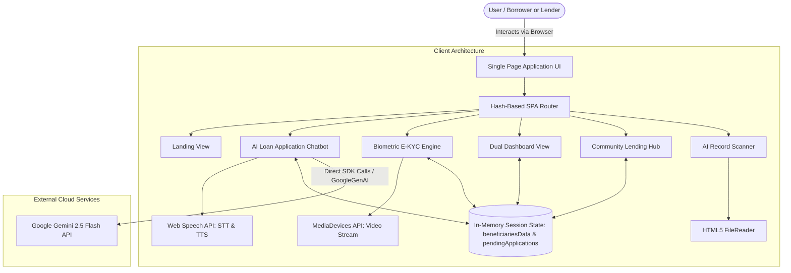
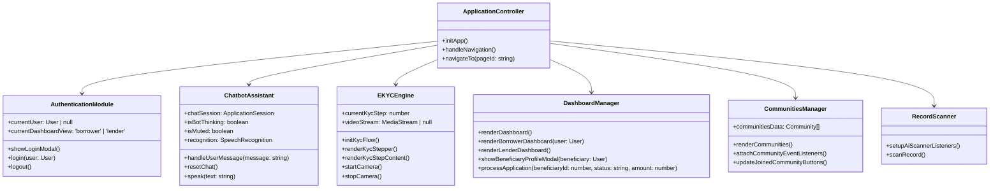
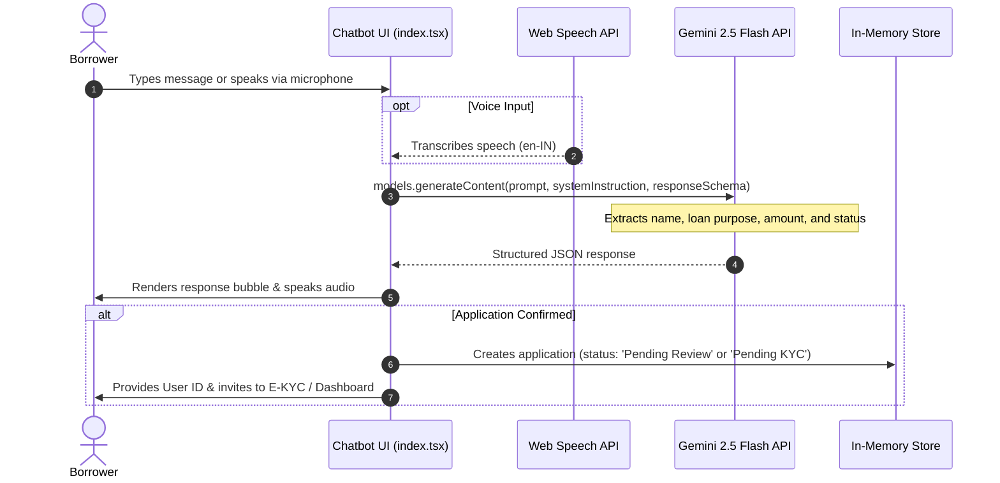
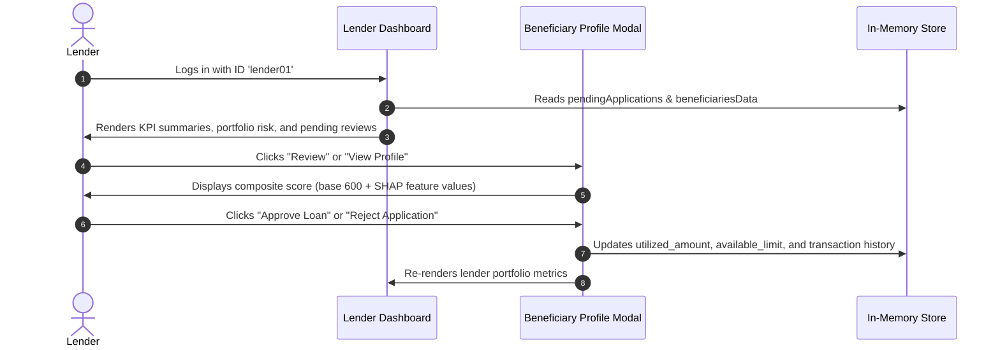

# SahayMitra Architecture

This document provides a detailed overview of the system architecture, component design, data flow, and technical decisions implemented in the **SahayMitra** prototype.

---

## 1. System Overview

SahayMitra is an AI-powered community lending and microcredit prototype designed for individuals with limited or non-traditional digital footprints. It provides:
1. **Conversational Loan Origination**: Multi-turn dialogue powered by Google Gemini (`gemini-2.5-flash`) with structured schema extraction and browser-native voice I/O.
2. **Explainable Alternative Credit Scoring (XAI)**: SHAP-style positive/negative feature contribution breakdowns.
3. **Simulated Biometric E-KYC**: Step-by-step onboarding leveraging browser webcam access and OTP verification.
4. **Dual-Persona Dashboards**: Tailored views for borrowers ("Living Loan" lifecycle, rewards, statements) and institutional lenders (portfolio KPIs, risk distribution, application approvals).
5. **Community Lending Hub**: Regional self-help lending circles and trust metrics.
6. **AI Paper Record Scanner**: A tool for field lenders to digitize physical ledger documents.

---

## 2. Component Architecture

Although future architectural refactorings have reserved component directories (`components/Phase1_Onboarding.tsx` through `Phase5_LoanMonitoring.tsx`), the current prototype executes as a modular client-side TypeScript application structured around `index.html` and `index.tsx`.

---

## 3. Data Flow

### 3.1. Conversational Loan Application Flow

### 3.2. Institutional Lender Approval Flow

---

## 4. Key Design Decisions

| Decision | Rationale | Trade-offs & Limitations |
| :--- | :--- | :--- |
| **Direct Client SDK Integration** (`@google/genai`) | Eliminates the need for a dedicated backend server during hackathon demonstrations, keeping setup to a single `npm run dev`. | Exposes the API key in client bundles if deployed publicly. Requires migrating to a secure backend proxy before production. |
| **Structured Output Schema** (`responseSchema`) | Constrains Gemini output to predictable JSON fields (`extractedName`, `extractedPurpose`, `extractedAmount`, `isApplicationComplete`), avoiding hallucinated parsing logic. | Model must support structured outputs (`gemini-2.5-flash`). |
| **In-Memory Mock State** | Allows interactive simulation of state transitions (loan repayment, limits, approvals, KYC step progression) without setting up a database. | State resets upon page refresh or process restart. |
| **Hash-Based Client Routing** | Simple, zero-dependency routing (`#landing`, `#apply-loan`, `#dashboard`, etc.) compatible with any static file server or preview environment without server-side rewrite rules. | URL history is simple; deep linking is limited to predefined view identifiers. |
| **Web Speech API Integration** | Lowers literacy barriers for rural/informal sector borrowers by enabling voice-first interaction without requiring heavy third-party audio streaming libraries. | Browser-dependent (supported primarily in Chromium-based browsers; fallback required for Safari/Firefox). |

---

## 5. Implementation Status: Real vs. Mocked

| Feature Area | Sub-Feature | Implementation Status | Implementation Detail |
| :--- | :--- | :--- | :--- |
| **AI Conversational Agent** | Natural Language Extraction | **Real** | Uses live Google Gemini 2.5 Flash API with JSON schema enforcement. |
| **AI Conversational Agent** | Speech-to-Text & Text-to-Speech | **Real** | Uses browser native `SpeechRecognition` and `SpeechSynthesis`. |
| **E-KYC Verification** | Camera feed | **Real** | Connects to hardware camera via `navigator.mediaDevices.getUserMedia`. |
| **E-KYC Verification** | Aadhaar & OTP | **Mocked** | Accepts hardcoded OTP `123456`. |
| **E-KYC Verification** | Facial Liveness Detection | **Mocked** | 2.5-second simulated timeout spinner before approval. |
| **Alternative Credit Scoring** | Score breakdown | **Simulated** | SHAP values calculated from mock feature weights on a 600-point base score. |
| **AI Record Scanner** | File selection & preview | **Real** | HTML5 file reader creates instant image preview. |
| **AI Record Scanner** | OCR Extraction | **Mocked** | Returns static sample CSV table after a 2.5-second simulation timer. |
| **Data Persistence** | User & loan state | **In-Memory** | Stored in JavaScript runtime arrays (`beneficiariesData`, `pendingApplications`). |
